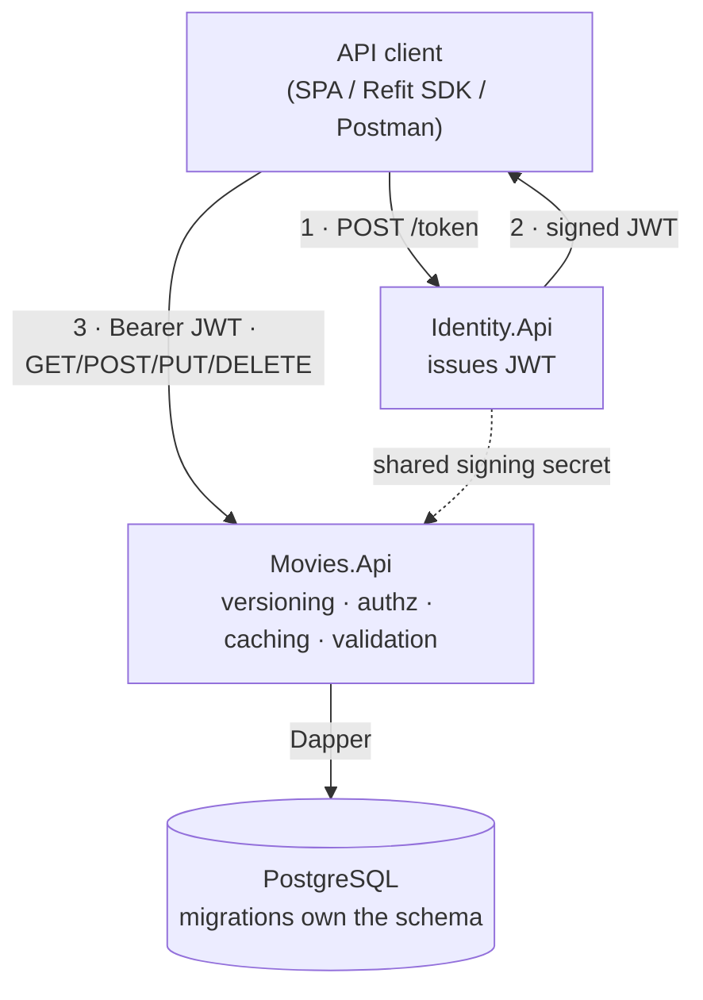

# Tewe Diary

[](https://sonarcloud.io/summary/new_code?id=hammayo_tewe-diary)
[](https://github.com/hammayo/tewe-diary/actions/workflows/deploy.yml)
[](https://dotnet.microsoft.com/)
[](https://www.postgresql.org/)
[](https://www.docker.com/)
[](_docs/azure-deployment.md)

A movie diary API: browse around 10,000 films imported from TMDB, rate the ones
you've seen and get your ratings back. I built it in .NET 10 as a portfolio piece,
so the films are the excuse and the engineering is the point.

It's production-shaped rather than feature-heavy. A separate Identity service issues
JWTs and the Movies API authorises against them with policies. Postgres sits behind
Dapper, with FluentMigrator owning the schema and separate least-privilege roles for
migrations, imports and runtime. Integration tests run against a real database in
Testcontainers. A script-and-CLI pipeline pulls and enriches the TMDB catalogue, and
GitHub Actions builds, tests, migrates and deploys to Azure.

> What I want a reader to see is where the boundaries sit, how authorisation is
> modelled, how the data layer stays testable and how the whole thing ships. Each
> trade-off, and when I'd revisit it, is in my [Design decisions](_docs/design-decisions.md).

## What it demonstrates

| Area                 | Practice shown                                                                                                                                              |
|----------------------|-------------------------------------------------------------------------------------------------------------------------------------------------------------|
| **API design**       | Resource-oriented routes, correct verbs + status codes, URL-segment **API versioning** (v1 controllers, v2 **Minimal APIs**), pagination, id-or-slug lookup |
| **Architecture**     | Clean/layered design with an enforced inward **dependency rule**; DTO ↔ domain mapping isolated at the edge                                                 |
| **Security**         | JWT bearer auth from a **separate Identity service**; **policy-based** authorization (`Admin`, `Trusted`); API-key filter for ops                           |
| **Performance**      | Response **output caching** with **tag-based eviction** on writes                                                                                           |
| **Data**             | **Dapper** over **PostgreSQL**; **FluentMigrator** versioned migrations; schema owned by migrations                                                         |
| **Testing**          | xUnit unit + **integration tests** against a real Postgres (Testcontainers), AAA style, `Bogus` data                                                        |
| **Tooling / DevOps** | Dockerised stack, a **CLI** for `migrate`/`import`, TMDB pipeline, **GitHub Actions** CI/CD with Azure Key Vault                                            |

## System at a glance



## Quickstart

```bash
cp .env.example .env          # fill in real values (see Getting started)
bash scripts/stack-up.sh      # build + start Movies API, Identity, Postgres
# Movies API → https://localhost:7001  (Swagger at /swagger)
```

Full setup, config, ports, and a token-and-create-a-movie `curl` walkthrough are in
[Getting started](_docs/_getting-started.md).

## Documentation

| Doc                                                   | What's in it                                                             |
|-------------------------------------------------------|--------------------------------------------------------------------------|
| [Getting started](_docs/_getting-started.md)          | Prerequisites, `.env` config, ports/URLs, run, quickstart `curl`         |
| [Architecture](_docs/architecture.md)                 | Dependency rule, layering, request pipeline, project map                 |
| [API reference](_docs/api.md)                         | Endpoints, authorization tiers, query params, error contract, versioning |
| [Design decisions & notes](_docs/design-decisions.md) | The deliberate trade-offs and when to revisit them                       |
| [Testing](_docs/testing.md)                           | Unit + Testcontainers integration strategy and conventions               |
| [CI/CD & deployment](_docs/ci-cd.md)                  | Build→test→migrate→deploy, Key Vault, DB role separation                 |
| [Azure deployment runbook](_docs/azure-deployment.md) | Step-by-step `az`/`gh` provisioning to enable the deploy pipeline        |
| [Workflows reference](.github/workflows/_README.md)   | Operational detail for the GitHub Actions workflows                      |
| [TMDB import runbook](_docs/tmdb-import.md)           | Data pipeline: fetch → transform → load                                  |

## Attribution

Movie data and images come from [TMDB](https://www.themoviedb.org).
This product uses the TMDB API but is not endorsed or certified by TMDB.

## Roadmap

- **React frontend** (placeholder shell in `frontend/`). A small React app that exercises the API end to end, so a reviewer
  can see it working without Postman or curl. It signs in through `Identity.Api`, keeps
  the JWT in memory and shows what each authorisation tier unlocks:
  - anonymous: the poster grid with title and year filters, sorting and paging, and a
    movie page built from the single GET (overview, tagline, trailer, director, writers
    and cast)
  - any signed-in user: rating and un-rating a movie, and a 'My ratings' view
  - `Trusted`: creating and editing movies, with validation errors shown inline from the
    `400` contract
  - `Admin`: deleting movies
- **Richer v2 browse API** (parked, see [the PRD](_docs/prds/_03-v2-browse-api-prd.md)). Genre filter, search and card
  payloads on top of the v2 Minimal API, with the SDK gaining a v2 client alongside it.
