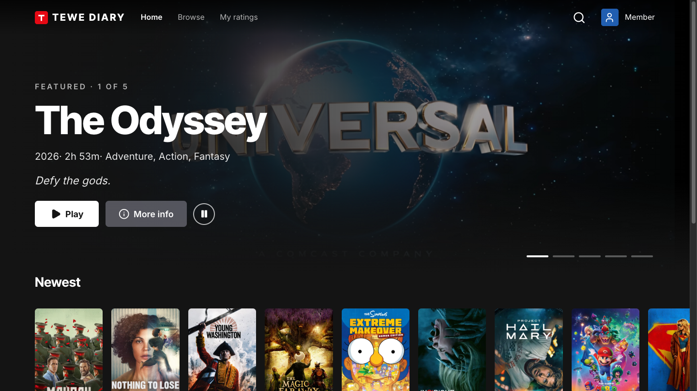
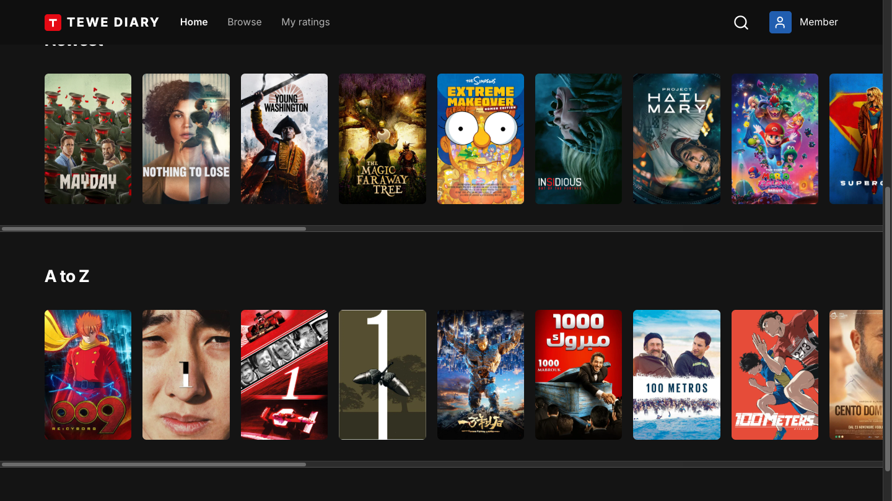
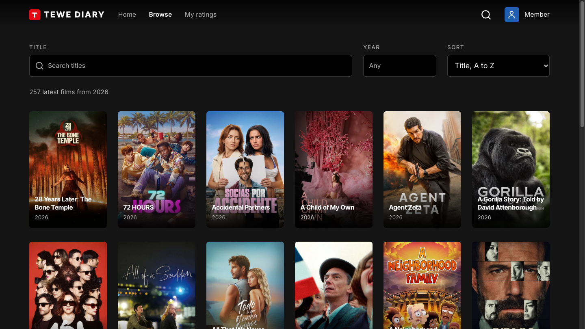
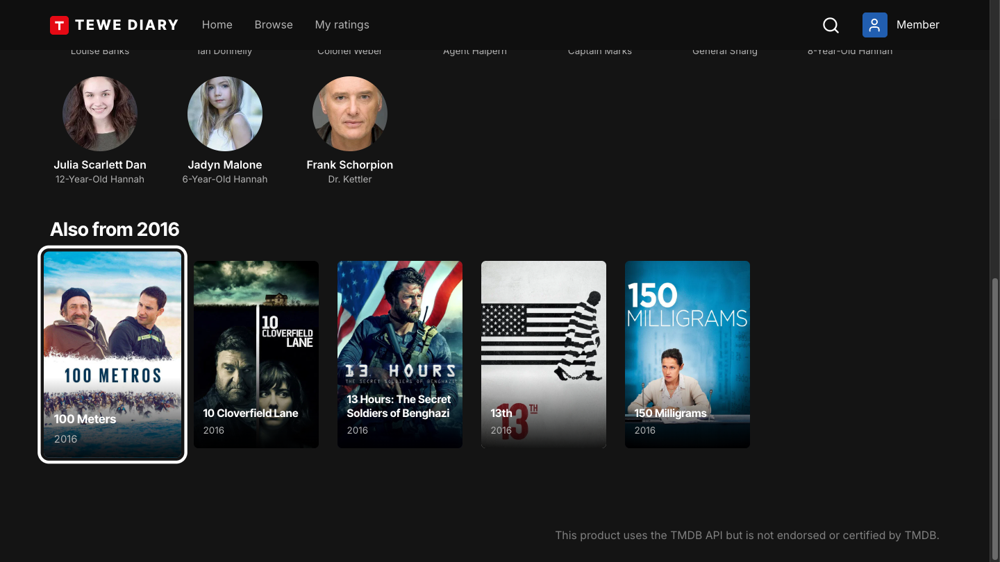
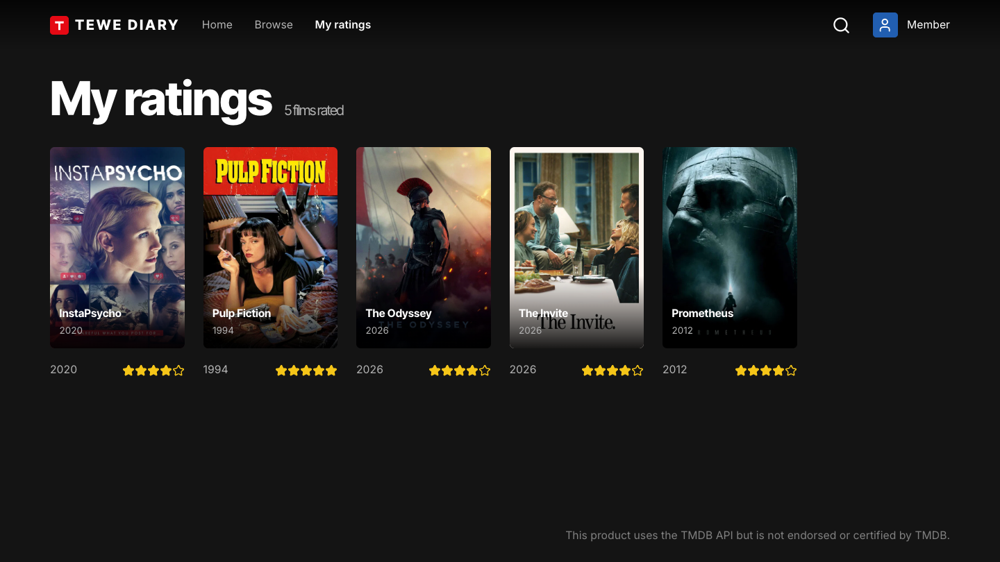
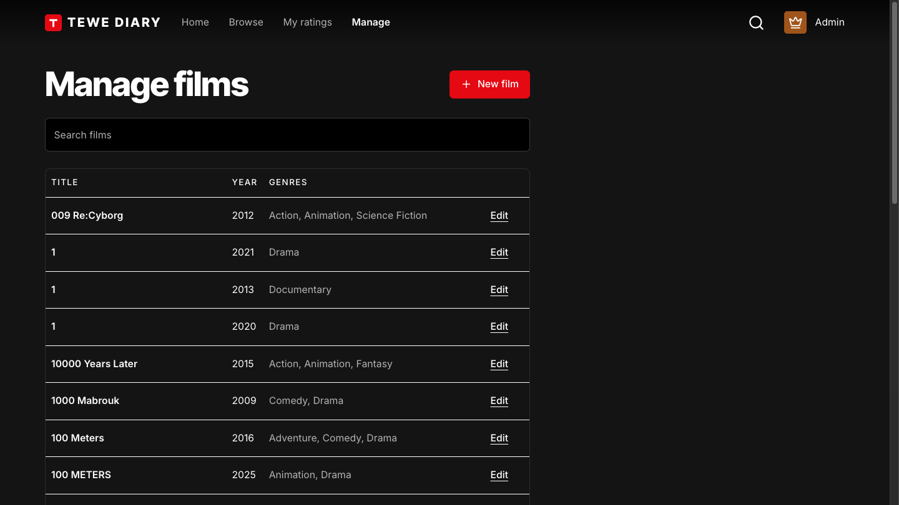
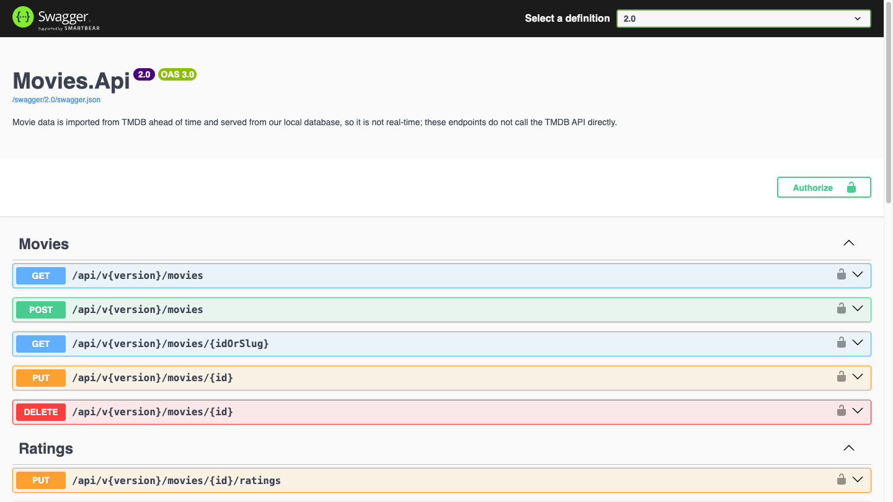

# Frontend screens

A tour of the React app in `frontend/`, taken from the running stack at 1440×810. To run it yourself, see
[Getting started](_getting-started.md#frontend). The screens that need a profile are shown as the profile I used for the
shot: ratings belong to a profile, so My ratings is the Member's (see [API reference](api.md) for the tiers).

## Who's watching?

The first screen. Member, Trusted and Admin ask Identity.Api for a token with that tier's claims, and Anonymous stays
signed out. It is a demo identity, not authentication: anyone can mint an Admin token, so I never deploy this build publicly.

## Home

A hero with a muted trailer behind the title. The five bars under it switch the featured film by mouse, or by arrow keys and
Enter. The films come from `HERO_SLUGS` in `.env` ([setting](_getting-started.md#frontend)).

Poster rows below the hero. Arrow keys move across cards and rows, and Enter opens a film.

## Browse

With nothing searched it lists the current year's films, and the count says so.

Title and year filters, sorting and paging. The URL holds the state, so a search can be bookmarked or shared.

## Movie

The movie page, with trailer, cast and my star rating. Opening a card from Home shows the same body in a modal.

Under the cast, **Also from <year>** lists up to five other films from the same year that have a poster, and opens the one you
pick. It uses the same year filter as Browse, so it needs no extra API.

## My ratings

The films the signed-in profile has rated. It is empty for a profile that has rated nothing.

## Manage

Create, edit and delete films. The screen is shown only to Trusted and Admin, and the API requires Admin to delete. The API
enforces the tiers itself: hiding the screen is convenience, not security.

## The API behind it

The frontend calls the **v2** endpoints. The base path is `API_BASE = "/api/v2"` in `frontend/src/api/client.ts`, and nginx
proxies `/api` to Movies.Api, so the browser never talks to it directly. The Swagger UI above is Movies.Api with the `2.0`
definition selected (open `https://localhost:7001/swagger/index.html?urls.primaryName=2.0`). v2 is Minimal API endpoints
beside the v1 controllers ([why](design-decisions.md#15-v2-as-minimal-apis-inside-moviesapi-and-one-place-for-the-net-version)).
